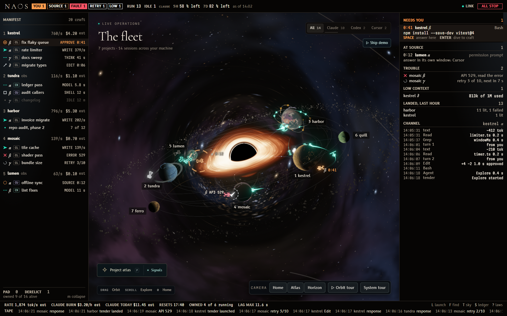
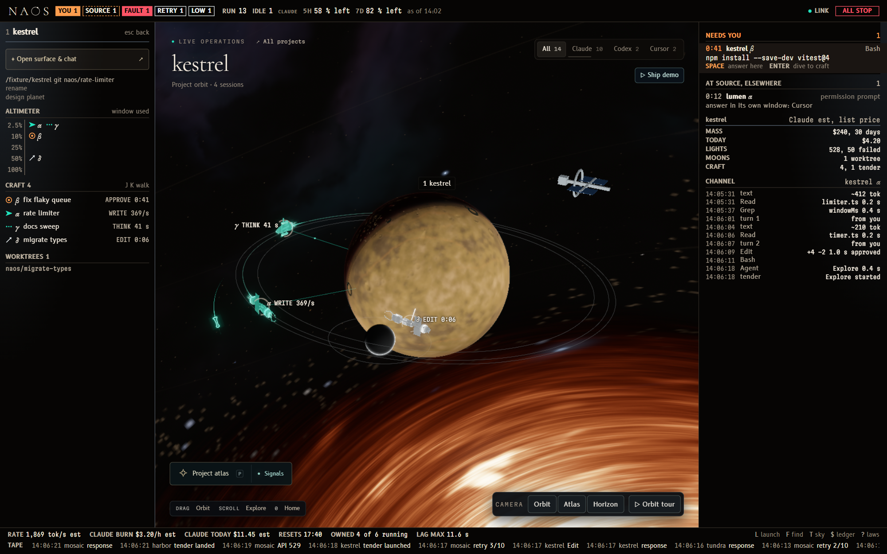
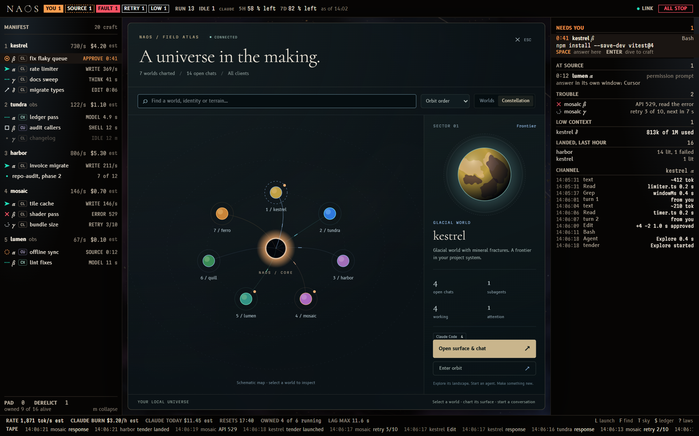
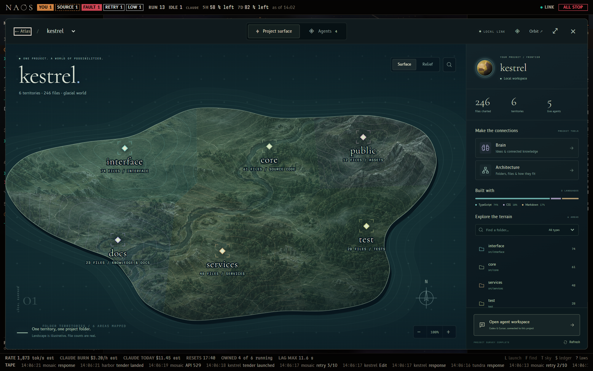

# NAOS

A local agent OS. Claude Code, Codex and Cursor sessions show up as craft in one solar system: a black hole at the centre, one planet per repository, and the work flying between them.

This is a side project, published as it stands. The longer write-up is still to come.

The pictures below are the fixture fleet, twenty scripted agents, not a live machine.









## Run

Node 24 or newer.

```text
npm install
npm run build
npm run fixture
```

`npm run fixture` replays the scripted fleet on 127.0.0.1 and opens no model calls. `npm run dev:ui` is the Vite dev server. `npm run app` starts NAOS against the sessions on this machine.

## What stays on your machine

`.naos/` holds tokens, the database, logs and the window profile. It is gitignored, and so are `.env` files and key material. NAOS does not read or store provider credentials. A picture of a real session is veiled before capture. The shots in this README are the fixture.
