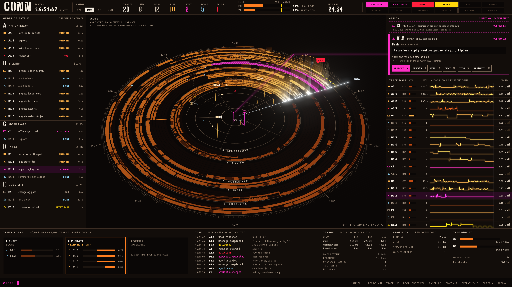
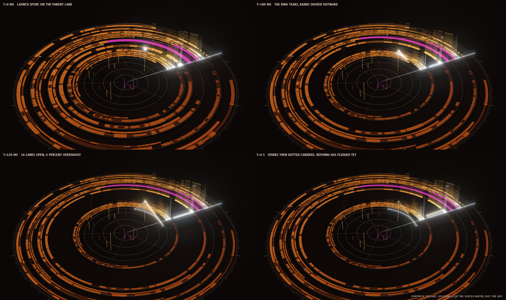
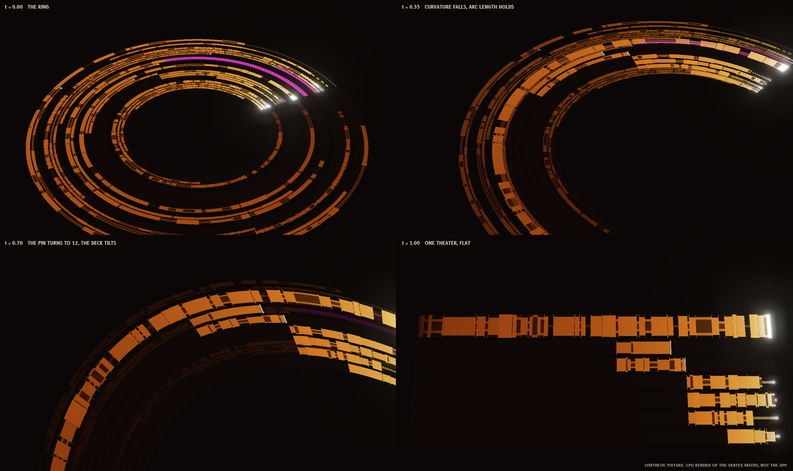
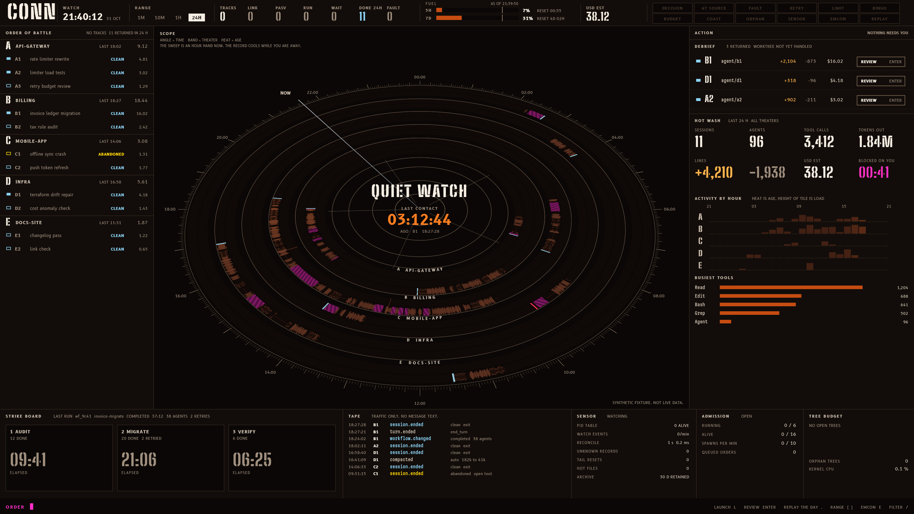

# CONN: the war room concept

UI concept for the Agent OS. Angle: a tactical war room, the most information-dense of the three concepts.
Written 2026-10-31. Nothing here is built. Facts come from `docs/research/`; everything else is a proposal.



*20 agents across 5 projects at 2560 x 1440. A CPU render of the planned shader maths, with the real fonts and a synthetic fixture. It is not the app. No browser was involved, and it says nothing about frame rate.*

**How claims are marked.**

| Tag | Meaning |
|---|---|
| **[V]** | VERIFIED: I ran it or read it in this session. Appendix B lists how |
| **[R xx n]** | VERIFIED in a research report by that report's own tags. `RF` is `runtime-formats.md`, `AC` is `agent-control.md`, `DS` is `design-skills.md`, `n` is the section |
| **[U]** | UNVERIFIED: a target, a judgement or an untested proposal |

Every design statement without a tag is a proposal, so it counts as [U]. Everything about frame rate is [U], because nothing here ran on a GPU.

---

## 1. Name, pitch, hero moment

### The name

**CONN.** The command is `conn`.

In naval use the conn is the authority to direct a ship's movement. Whoever gives orders to the helm holds it, the crew must always know who that is, and a senior officer takes it by announcing "I have the conn". [V: Wikipedia, *Conn (nautical)* and *Officer of the deck*]

That word is this product's security model. A parent agent cannot approve for a child, approvals always go to the human, and the kernel must not build a route around that [R AC 12.4]. So the boot sequence ends on one line: `YOU HAVE THE CONN`. Agents may prompt agents. The conn stays with you.

`conn` is not on PATH here, and files named `conn` and `conn.cmd` create normally on this machine [V]. A dormant npm package with that name exists (0.0.4, last touched 2022) [V]. That does not matter for a private tool, but a public release would need another package name.

The deck shows raw model ids and entrypoints as data. It uses no logos and borrows no branding.

### The pitch

CONN is a combat information center for every agent on your machine: it reads their traffic without reading their words, burns it into one circular record where heat is age, and leaves a single magenta line for what needs you.

### The hero moment: the SALVO

One agent launches sixteen, and the disc tears open.



*The salvo at 0 ms, 180 ms, 420 ms and 6 s. CPU render, synthetic fixture.*

| Time | What you see | Real signal |
|---|---|---|
| 0 ms | A white-hot radial spoke lands on the parent lane at the sweep. The parent's contact flares in the plot | First `started` lines in `journal.jsonl`, about 18 ms behind the write [R RF 4.4, 5.1]. On linked agents, `system/task_started` or the kernel's own `agent_spawn` [R AC 2.10, 12] |
| 0 to 420 ms | The ring tears. Lanes are whole rings, so a dark gulf opens around the entire disc and every band outside it is shoved outward, with 6 percent overshoot | One lane per `agent.started`. 3 or more under one parent within 1 s count as a salvo [U] |
| 180 ms on | One chevron per agent flies out of the parent contact along a hairline, and settles into a formation arc | Same events |
| 420 ms | The new lanes are empty, because they have no history. Only the sweep is lit: a column of sparks, one per first model call | `api-request`, written at request start [R RF 0.4] |
| 600 ms | Rows slide into the wall under a bracket from the parent. The strike board opens its phases. The tape prints `SALVO wf_9c41 16 TRACKS` | `started.phase`, `started.label` [R RF 4.4] |
| 6 s | Passive lanes show dotted carriers, because nothing has flushed yet. Then the first responses arrive and re-ink the stretch behind the sweep | Records can reach disk up to 46 s late [R RF 0.2] |
| Forever | The spoke stays burned into the record at its time. A day later the 24H scope still shows every fan-out | The record itself |

This is the moment the brief asks for, the one where "Claude promptet seine eigenen Claudes" becomes something you can see. It repeats on real work, and it is honest: the dark gulf and the dotted carriers exist because passive agents really have reported nothing yet.

### The three second read

A black room. A burning disc, white-hot at one edge and cooling through amber and rust to nothing around the ring. A thin blue-white line scorches its way across it. Tiny stalked glyphs stand in the middle. A wall of heartbeats runs down the side. One magenta line crosses the entire screen to the only thing that matters. It does not look like a dashboard, and every mark on it is a real event.

### The six laws

Everything else in this document follows from these.

1. **Traffic, not text.** Traffic analysis deduces information from patterns in communication, and it works even when messages cannot be read [V: Wikipedia, *Traffic analysis*]. That is exactly what the Observer plane is. Transcripts are private, so the deck draws timing, size and type. Words stay sealed until you declassify one row.
2. **Heat is age.** Every mark is burned in hot and cools on a fixed clock. Data age is never hidden, because the disk delivers bursts, not streams [R RF 0.1, 0.2].
3. **Dark cockpit.** Airbus panels stay dark when systems are normal, and a light means action is needed [V: Airbus ICAO deck, A330neo cockpit paper]. Nothing on this deck glows without a reason. Dark means fine.
4. **Magenta belongs to the human.** It is the only colour outside the machine's vocabulary. If it is magenta, it is waiting on you or it came from you.
5. **Never imply authority you do not have.** A read-only observer cannot answer, message or stop a session it did not start [R RF 8]. Those sessions get no buttons.
6. **The metaphor stops at the trigger.** Instruments may have cinematic names. States and buttons use plain words. `APPROVE`, `DENY` and `STOP` will never be called anything else.

---

## 2. The metaphor and its mapping

The deck is the combat information center of a warship that fights by traffic analysis. Agent work reaches the operator the way radar returns do: in bursts, late, and with no content. So the scope is a phosphor record, a quiet contact coasts between fixes, and a late return lands behind the sweep.

### Every entity

| Entity | On the deck | On the scope | On the plot | Wall, ORBAT, panels | Driven by |
|---|---|---|---|---|---|
| Project | **Theater**, a letter A to Z, stable for the watch | A band of lanes with its legend engraved in the gap before it | A sector of bearing | Header row with cost | `projectRoot`, never the slug [R RF 3.3] |
| Session | **Flagship**, track `B1` | A lane 1.55 times thick, on the outer edge of its group | A rectangle on a stalk, filled if LINK, hollow if PASV | Row with state, age, title | `ObservedSession` |
| Subagent | **Sortie**, track `B1.4` | A lane inside its parent | A triangle tethered to the parent | Indented row | `ObservedAgentNode`, `spawnDepth` |
| Workflow | **Strike**, `wf_9c41` | A bracket around its lanes, plus the salvo spoke | A formation arc of chevrons | STRIKE BOARD | `ObservedWorkflow`, journal |
| Phase | **Wave** | A hairline tick where its first agent appears | Sub-groups in the arc | A column on the strike board. Bars show elapsed time, because no agent reports progress | `started.phase`, grouped by value [R RF 4.4] |
| Tool call | **Emission** | Hollow rails. Height is the tool class | Nothing, too fine | Flat top in the trace, line on the tape | `tool.started`, `tool.finished` |
| Approval request | **Decision** | A hatched magenta band that grows behind the sweep for as long as it waits | The contact flies inbound to YOU | ACTION card, magenta line, lamp | `approval.requested` [R AC 9.1] |
| Token stream | **Signal** | Solid blocks. Height is log output tokens. Jagged on LINK, flat on PASV | Nothing, too fine | Trace amplitude, RATE column | `stream_event` deltas, `message.completed` |
| Cost | **Fuel** | Nothing, the disc shows time | Nothing | FUEL tapes, USD column, tree budgets | Plan windows first, USD second [R AC 6] |
| Error | **Fault** | A notch through the lane plus a rim chevron with the track number | Lit glyph | `FAULT` lamp, row state, tape | `api.error`, `errored`, `crashed` |
| Idle | **Station keeping** | A thin baseline and no ink | Contact drifts to the outer ring | Flat trace | `idle` |
| Finished | **Returned** | An ice end cap. The lane stays until the sweep has passed it once more | Contact fades out | `DONE`, debrief queue | `session.ended`, `agent.ended` |

**Track numbers** replace 17 character ids. `B1.4` is theater B, session 1, agent 4: short, positional, stable for the watch, and it reads as a chain of command. You can type it into the order line.

### The instruments

Each instrument answers one question.

| Instrument | Question | Plane |
|---|---|---|
| LAMPS | Does anything need me? | DOM |
| ACTION | What exactly, and what do I answer? | DOM |
| SCOPE | What happened, in what order, across everything? | WebGL |
| PLOT | Who is closest to needing me, and how full are they? | WebGL |
| WALL | Is each agent loop healthy right now? | Canvas 2D |
| ORBAT | Who exists, and who commands whom? | DOM |
| STRIKE BOARD | Where is each workflow? | DOM |
| TAPE | What exactly just happened? | DOM |
| FUEL | How long can this continue? | DOM |
| SENSOR | Can I trust what I am seeing? | DOM |
| ADMISSION | Can I launch? | DOM |
| ORDER | The command line. Everything can be typed | DOM |

### LINK and PASV: two kinds of track

This is the most important distinction on the deck, and in the render it is visible without a legend: linked traces are jagged, passive traces move in square steps.

| | **LINK**: the OS spawned it | **PASV**: the OS only watches it |
|---|---|---|
| Source | The SDK stream the kernel holds | `~/.claude` on disk |
| Glyph | Filled | Hollow |
| Token data | Live deltas, estimated rate [R AC 2.3] | Known only when a response ends [R RF 0.1] |
| Lane look | Jagged live envelope | Flat block, height from `usage` |
| Latency | Live | 136 ms to 1.3 s on main, up to 46 s on workflow agents [R RF 5.2] |
| Compaction | A live state | An event after it ended [R RF 3.5] |
| Approvals | Answered here | Named here, answered at the source |
| Buttons | SEND, REDIRECT, STOP, RESUME, FORK, +FUEL | None while it runs |

### Track quality

Between records a passive agent coasts, like a radar track between returns. The FIX column shows four bars for the age of the last record. The thresholds come from measured gaps between flushes on workflow agents: p50 4.6 s, p90 24 s, max 72.6 s [R RF 5.2].

| Bars | Age of last fix |
|---|---|
| 4 | under 5 s, always on LINK |
| 3 | under 25 s |
| 2 | under 75 s |
| 1 | under 120 s |
| 0 | 120 s or more while busy. Lights `COAST` |

Nothing alarms under 120 s [R RF 0.2]. `COAST` means "no fix", never "stalled".

### Honest numbers

| Mark | Meaning | Rule |
|---|---|---|
| `~` | Estimated | Every passive rate and every value not yet confirmed |
| `≥` | Lower bound | `isLowerBound`, messages with partial output [R RF 3.3] |
| `EST` | List price | USD on a Max login is an estimate, not a bill [R AC 6] |
| `AS OF` | Age of the data | FUEL always shows `fetchedAtMs` [R RF 7] |

### How 20 agents stay readable

Density works because reading has depth. You stop as soon as you have your answer.

| Depth | Time | Look at | You learn |
|---|---|---|---|
| 1 | 1 s | Lamps | Dark means nothing needs you |
| 2 | 5 s | Scope and plot | Where the heat is, who is inbound |
| 3 | 30 s | Wall, strike board, tape | Which loop is unhealthy, where each workflow stands |
| 4 | minutes | Zoom | What exactly one agent did |

Four stability rules protect it:

- **Nothing reorders.** Theaters and lanes keep their place for the whole watch. New lanes open in place.
- **ACTION never moves,** at any zoom level. Your hands learn where decisions live.
- **Decisions are one queue,** oldest first, across all projects. New cards join at the bottom and never swap under your finger.
- **Colour never identifies a project.** Position and letter do. There is no rainbow.

---

## 3. Wireframes

Keys, valid everywhere: `Y` `N` decide, `J` `K` next and previous track, `Enter` zoom in, `Esc` zoom out, `[` `]` range, `L` launch, `/` filter, `E` EMCON, `D` declassify, `.` replay, `T` top-down scope.

**EMCON** is emissions control. It replaces every title, path and branch with track numbers and lights a lamp. It is for screen shares, and it seals all declassified rows.

### Overview

```text
┌──────────────────────────────────────────────────────────────────────────────────────────────────────────────────────────────────┐
│ CONN │ 14:31:47 │ 1M [10M] 1H 24H │ TRK 20 LINK 8 PASV 12 │ RUN 10 WAIT 2 DONE 5 FAULT 1 │ 5H ██░|░ 41% 7D █░░|░ 23% │ $24.34 EST│
│ [█DECISION█][░AT SOURCE░][█FAULT█][█RETRY█]  limit bingo budget coast orphan sensor emcon replay    dark means normal            │
├──────────────────────────────┬────────────────────────────────────────────────────────────────┬──────────────────────────────────┤
│ORDER OF BATTLE      20 TRACKS│ SCOPE  angle=time  band=theater  heat=age                      │ACTION          2 NEED YOU, OLDEST│
│A API-GATEWAY            $6.42│ PLOT   bearing=theater  range=urgency  stalk=context           │┄┄┄┄┄┄┄┄┄┄┄┄┄┄┄┄┄┄┄┄┄┄┄┄┄┄┄┄┄┄┄┄┄┄│
│ ■ A1   rate limiter   RUN .1s│                                                                │□ C1 MOBILE-APP  perm prompt 02:13│
│ ▲ A1.1 Explore        RUN .2s│                             14:30                              │READ ONLY. ANSWER AT SOURCE       │
│ ▲ A1.2 limiter tests  RUN .1s│                       ···   ▓▓      ···                        │claude-vscode pid 21744           │
│ ▲ A1.3 review diff  FAULT 34s│                 · ▒▒▒▒▒▒▒▒▒▓▓▓      ▓▓▓▓▓   ·                  │━━━━━━━━━━━━━━━━━━━━━━━━━━━━━━━━━━│
│B BILLING               $11.07│             ·  ▒▒▒▒▒  ▒▒▒   ▓▓   ▓▓▓▓▓▓    ▓▓▓▓ ·              │▲ D1.2 INFRA apply plan      00:42│
│ □ B1   ledger migr.  RUN 4.8s│          · ▒▒▒         ▒    #####    ▓▓▓▓▓▓▓  ▓    ·           │Bash  WANTS TO RUN                │
│ ^ B1.1 audit schema DONE 171s│        ·▒      ▒▒▒  ▒▒▒▒▒           #####  ▓▓### ███ · NOW     │  terraform apply -auto-approve   │
│ ^ B1.2 audit callrs DONE 148s│      ·  ▒▒ ▒▒   ▒▒▒  ▒▒▒▒▒▒▒▓▓▓▓▓▓▓▓▓▓▓▓  ### ####   ██·       │  staging.tfplan                  │
│ ^ B1.3 ledger core    RUN 22s│    ·     ▒▒▒  ▒▒  ▒▒▒▒▒   ▒▒▓▓▓▓▓▓▓   ▓▓▓▓▓  ##  ### ████·     │PATH envs/staging/  IN WORKTREE   │
│ ^ B1.4 tax rules     RUN 3.1s│   ·▒▒▒ ▒▒▒▒ ▒▒ ▒▒▒▒  ▒▒▒▒▒▒       ▓       ████ ## ###******    │[APPROVE Y][ALWAYS S][EDIT E]     │
│ ^ B1.5 exports        RUN 41s│  ·    ▒▒▒ ▒▒   ▒▒ ▒▒▒▒    ···   ···    ▓███ ████******     ·   │[DENY N][STOP X][REDIRECT R]      │
│ ^ B1.6 webhooks r1   RUN 7.9s│ ·▒▒▒ ▒▒▒ ▒▒      ▒▒▒ ■A1             □B1 ██******           ·  ├──────────────────────────────────┤
│C MOBILE-APP             $1.93│  ▒▒▒ ▒▒ ▒▒ ▒▒▒▒ ▒▒   ·    ··     ··   ····**                   │TRACE WALL CTX RATE 60 S  USD FIX │
│ □ C1   offline   SOURCE 2:13 │· ▒▒ ▒▒▒ ▒▒ ▒▒▒ ▒▒▒  ·■D1·        ▲D1.2· ·                    · │A1   ▓▓░ 312 ▁▅▂▇▃▂▅▁▂▆▃ 2.84 ▂▄▆█│
│ △ C1.1 Explore      DONE 141s│·14:27▒▒ ▒▒ ▒▒▒ ▒▒       ·    YOU·   ·                    14:23 │A1.1 ▓░░ 188 ▃▂▅▃▆▂▃▅▂▃▆ 0.31 ▂▄▆█│
│D INFRA                  $4.18│· ▒▒ ▒▒▒ ▒▒ ▒▒▒ ▒▒▒  ·   ·           □C1 ·                    · │A1.2 ▓░░ 241 ▂▃▂▅▂▃▂▆▂▃▅ 0.92 ▂▄▆█│
│ ■ D1   terraform      RUN .1s│  ▒▒▒ ▒▒    ▒▒▒▒□E1   ·    ··     ··    ·                       │A1.3 ▓░░   0 ▂▅▃▆▂▁_____ 0.44 ▂▄  │
│ ▲ D1.1 state files    RUN .3s│ ·▒▒▒ ▒▒▒ ▒▒ ▒▒▒░ ░░░   ·             ·   ░░░                ·  │B1   ▓▓▓   ~ ▅▅▂▂▂▅▅▅▅▂▅ 7.61 ▂▄▆ │
│▐▲ D1.2 staging pln DECIDE 42s│  ·▒▒▒ ▒▒▒ ░░ ░░░░ ░░░░    ···   ···    ░░░░         ░      ·   │B1.3 ▓░░   ~ ▂▂▂▅▂▂▂____ 0.74 ▂▄▆ │
│ ▲ D1.3 summarize     DONE 96s│   ·▒▒░ ░░░  ░░ ░░░░  ░░░░░░       ░░░░░░  ░░░░     ░░░    ·    │B1.4 ▓░░   ~ ▂▅▂▂▅▂▂▂▅▂▂ 0.58 ▂▄▆█│
│E DOCS-SITE              $0.74│    ·░░░░   ░  ░░  ░░░░░   ░░░░░░░░░   ░░     ░░  ░   ░░░░·     │B1.5 ▓░░   ~ ▅▂▂▂___.... 0.09 ▂▄  │
│ □ E1   changelog     IDLE 74s│      ·░░░░ ░░░░ ░░░  ░░A API-GATEWAY ░░░  ░░░ ░░░░     ·       │C1   ▓▓░   0 ▂▂▂▂▂▂▂▂▂▂▂ 1.71 ▂▄▆ │
│ △ E1.1 link check   DONE 214s│        ·░░░  ░░░░░  ░░░░░ B BILLING ░░░░   ░░░░░ ░░░░·         │D1   ▓▓░  96 ▅▃▂▆▃▂▂▅▃▂▆ 2.92 ▂▄▆█│
│ △ E1.2 shots       RETRY 2/10│          ·  ░░░  ░░░░░░░    ░░       ░░░░░░░     ░ ·           │D1.2 ▓░░   0 ▂▅▃▂▂▂▂▂▂▂▂ 0.81 ▂▄▆█│
│                              │             · ░░░░░░  ░░░░░░░░░░░░░░░░░  ░░░    ·              │E1.2 ▓░░   0 ▂ ▂ ▂ ▂ ▂ ▂ 0.05 ▂▄▆█│
│■ LINK flagship  □ PASV       │                 · ░░░░░░░░░░░░  ░░░░░░░░░░░ ·                  │... 8 more rows, 20 in all        │
│▲ LINK sortie    △ PASV       │                       ···   ░░  ░   ···                        │                                  │
│^ strike agent   ▐ selected   │                             14:25                              │jagged = LINK, live frames        │
│                              │ # hatched: waiting on you  █▓▒░ heat is age  SYNTHETIC EXAMPLE │stepped = PASV, disk flushes      │
├──────────────────────────────┴─────────────┬──────────────────────────────────────────────┬───┴────────────────┬─────────────────┤
│ STRIKE BOARD  wf_9c41 invoice-migrate      │ TAPE  traffic only, no message text          │ SENSOR             │ ADMISSION  LINK │
│ 1 AUDIT      2 MIGRATE       3 VERIFY      │ 14:31:46 A1.2 tool.finished      ok 4.1 s    │ main  p90 790 ms   │ running  2 / 6  │
│ 2 done       4 run, 1 retry  not started   │ 14:31:44 B1.4 message.completed  lag 3.1     │ agent p90 11.6 s   │ alive    2 / 16 │
│ ^B1.1 ███    ^B1.3   ░░███   no agent has  │ 14:31:43 E1.2 api.retry          2/10 +8s    │ agent max 43.6 s   │ spawn/m  2 / 10 │
│ ^B1.2 █████  ^B1.4   ░░███   reported this │ 14:31:38 A1   request.started    opus-5-5    │ watch  41/min      │ queued   1      │
│              ^B1.5   ░░███   phase         │ 14:31:13 A1.3 api.error          529         │ unknown recs  0    │ TREE BUDGET     │
│              ^B1.6 r1 ░░░██                │ 14:31:05 D1.2 approval.requested Bash        │ tail resets   0    │ A1 $6.42 / $20  │
│ bars are elapsed time, on one shared axis  │ 14:30:23 B1.6 agent.started      retry 1     │ hot files    37    │ D1 $4.18 / $10  │
│ no agent reports progress, so none shows   │ 14:30:22 B1.3 message.completed  lag 22 s    │ kernel link ok     │ orphans  0      │
├────────────────────────────────────────────┴──────────────────────────────────────────────┴────────────────────┴─────────────────┤
│ ORDER ▌                       LAUNCH L   DECIDE Y N   TRACK J K   ZOOM ENTER ESC   RANGE [ ]   EMCON E   DECLASSIFY D   REPLAY . │
└──────────────────────────────────────────────────────────────────────────────────────────────────────────────────────────────────┘
```

### Zoom into a theater

The band unrolls into a flat wall. The ring shrinks to an inset, so a decision elsewhere can never hide.

```text
┌──────────────────────────────────────────────────────────────────────────────────────────────────────────────────────────────────┐
│ CONN │ 14:31:47 │ 1M [10M] 1H 24H │ TRK 20 LINK 8 PASV 12 │ RUN 10 WAIT 2 DONE 5 FAULT 1 │ 5H ██░|░ 41% 7D █░░|░ 23% │ $24.34 EST│
│ [█DECISION█][░AT SOURCE░][█FAULT█][█RETRY█]  limit bingo budget coast orphan sensor emcon replay    dark means normal            │
├────────────────────────┬────────────────────────────────────────────────────────────────────────────────┬────────────────────────┤
│ ORBAT                  │ THEATER B  BILLING   repo billing   main   1 FLAGSHIP  6 SORTIES   $11.07 EST  │ ACTION   never moves   │
│ A API-GATEWAY  4  ▂▄▆█ │      14:22  14:23   14:24  14:25  14:26   14:27  14:28  14:29  14:30   14:31   │ ▲ D1.2 INFRA     00:42 │
│                        │                                                                          NOW▼  │ Bash terraform apply   │
│ B BILLING      7       │      ┼──────┼──────┼──────┼──────┼──────┼──────┼──────┼──────┼──────┼──────┼─┼ │ [APPROVE Y][DENY N]    │
│  □ B1   RUN 4.8s       │ B1   ███▂▂▂▂▂▂▂▂▂▂▂▂▂▂▂██████▂▂▂███▂▂▂▂▂▂▂▂▂▂▂▂███▂▂▂▂▂▂▂▂▂▂▂▂███████████████▂ ├────────────────────────┤
│  ^ B1.1 DONE           │ block height is log output tokens, width is real duration, rails are tools     │ THEATER BRIEF          │
│  ^ B1.2 DONE           │                                               ┃                                │ root   C:/dev/billing  │
│  ^ B1.3 RUN  22s       │               salvo spoke, burned into record ┃                                │ branch main            │
│  ^ B1.4 RUN 3.1s       │ B1.1                                           ██████████┃                     │ worktrees  0           │
│  ^ B1.5 RUN  41s       │                                                                                │ sessions   1 alive     │
│  ^ B1.6 RUN 7.9s       │ B1.2                                           █████████▂▂▂┃                   │ agents     4 running   │
│                        │ ┃ ice end cap: agent returned                                                  │ tool calls 412         │
│ C MOBILE-APP   2  #    │                                                                                │ tokens out 88.4k       │
│ D INFRA        4  #    │ B1.3                                                         █████████████▂▂.  │ usd        $11.07 EST  │
│ E DOCS-SITE    3       │                                                                                │ lag now    p90 22 s    │
│                        │ B1.4                                                         ███████▂▂▂███▂▂▂█ │                        │
│ THE RING STAYS         │                                                                                │ LAUNCH INTO THEATER  L │
│    .-▒▒▒▓▓*.           │ B1.5                                                         █▂▂▂█████████. .  │                        │
│   ( ░      █)          │                                                                                │                        │
│    `-░░░▒-'            │ B1.6                                                                ███▂▂▂▂▂▂█ │                        │
│                        │                                                                                │                        │
│ inset scope, live.     │ dots at the right edge: request in flight, nothing has flushed yet             │                        │
│ Other bands stay       │ Ring and wall are one mesh: the same lanes, flattened, parent on top.          │                        │
│ visible, so a decision │ Hover gives a crosshair with the exact time and the event under it.            │                        │
│ elsewhere cannot hide  │                                                                                │                        │
│ while you work here.   │ CHAIN OF COMMAND  3D plot, inset                                               │                        │
│                        │ B1 ──┬── wave 1 AUDIT    B1.1  B1.2                                            │                        │
│ ESC rolls it back up   │      └── wave 2 MIGRATE  B1.3  B1.4  B1.5  B1.6(r1)    wave 3 VERIFY  no agent │                        │
│                        │                                                                                │                        │
├────────────────────────┴────────────────────────────────────┬───────────────────────────────────────────┴────────────────────────┤
│ STRIKE BOARD  wf_9c41  invoice-migrate  PASSIVE  OWNER B1   │ TAPE  filtered to theater B                                        │
│ 1 AUDIT 2 done  2 MIGRATE 4 run 1 retry  3 VERIFY none yet  │ 14:31:44 B1.4 message.completed  2.1k out  thinking tool_use       │
│ a retry shows as a new agent on the same key                │ 14:30:23 B1.6 agent.started      retry 1 of key v1:3fa2            │
│ phases can interleave, so they group by name                │ 14:30:22 B1.3 message.completed  3.8k out  tool_use  lag 22 s      │
│                                                             │                                                                    │
├─────────────────────────────────────────────────────────────┴────────────────────────────────────────────────────────────────────┤
│ ORDER ▌                                                TRACK J K   ZOOM ENTER   BACK ESC   RANGE [ ]   TOP DOWN T   DECLASSIFY D │
└──────────────────────────────────────────────────────────────────────────────────────────────────────────────────────────────────┘
```

### Zoom into one agent

Text is sealed by default. Bars have the true length of what they hide. `D` fetches one row on demand, because no event ever carries message text [R RF 9]. Thinking has no text to fetch: those blocks arrive with `thinking: ""` and a signature [R AC 2.3].

```text
┌──────────────────────────────────────────────────────────────────────────────────────────────────────────────────────────────────┐
│ CONN │ 14:31:47 │ 1M [10M] 1H 24H │ TRK 20 LINK 8 PASV 12 │ RUN 10 WAIT 2 DONE 5 FAULT 1 │ 5H ██░|░ 41% 7D █░░|░ 23% │ $24.34 EST│
│ [█DECISION█][░AT SOURCE░][█FAULT█][█RETRY█]  limit bingo budget coast orphan sensor emcon replay    dark means normal            │
├────────────────────────┬────────────────────────────────────────────────────────────────────────────────┬────────────────────────┤
│ ORBAT                  │ TRACK A1.2  write limiter tests  ▲ LINK  sonnet-5-5 high  agent/a1.2  PARENT A1│ ACTION   never moves   │
│ A API-GATEWAY          │ BIG TRACE  last 60 s  each pulse is one event                                  │ nothing for this track │
│  ■ A1                  │┄┄┄┄┄┄┄┄┄┄┄┄┄┄┄┄┄┄┄┄┄┄┄┄┄┄┄┄┄┄┄┄┄┄┄┄┄┄┄┄┄┄┄┄┄┄┄┄┄┄┄┄┄┄┄┄┄┄┄┄┄┄┄┄┄┄┄┄┄┄┄┄┄┄┄┄┄┄┄┄│                        │
│  ▲ A1.1                │ ▄▄                            ▄▄    ▄▄    ▄▄              ▄▄    ▄▄  ▄▄         │ TELEMETRY              │
│ ▐▲ A1.2  <             │ ██▄▄    ▄▄▄▄                ▄▄██    ██    ██          ▄▄  ██▄▄▄▄██▄▄██         │ CONTEXT ALTITUDE       │
│  ▲ A1.3 FAULT          │ ████▄▄▄▄████              ▄▄████▄▄  ██    ██        ▄▄██▄▄████████████▄        │  200k ┤ window         │
│ B BILLING     7        │ ████████████  ▄▄          ████████  ██    ██▄       ███████████████████        │       │    /|   /      │
│ C MOBILE-APP  2 #      │ ████████████▄▄██▄▄▄▄▄▄▄▄▄▄████████▄▄██▄▄▄▄███▄▄▄▄▄▄▄███████████████████▄▄▄▄▄▄▄ │       │  /  | /        │
│ D INFRA       4 #      │ ────────────────────────────────────────────────────────────────────────────── │       │/    |/ compact │
│ E DOCS-SITE   3        │ ticks: api-request  spikes: live tokens  flat tops: tools  one beat: one loop  │   62k ┤ now 31%        │
│                        ├────────────────────────────────────────────────────────────────────────────────┤ in 18k  out 6.2k       │
│                        │ TRANSMISSION LOG  file order, never timestamp order        D declassifies a row│ cache r340k w41k       │
│ THE RING STAYS         │ 14:31:12.204 REQ sonnet-5-5  ttft 1.4 s                                        │ rate 241/s est         │
│    .-▒▒▓*.             │ 14:31:13.610 THK ▓▓▓▓▓▓▓▓▓▓▓▓▓▓▓▓▓▓▓▓▓▓▓▓             328 tok  SIGNED, NO TEXT │ loop 11/min            │
│   ( ░    █)            │ 14:31:15.881 TXT ██████                                          66 ch  SEALED │ ttft 1.1 s             │
│    `-░░▒-'             │ 14:31:15.903 USE Bash  ██████████████                           412 ch  SEALED │ R14 W3 X6 N0 A0 M0     │
│                        │ 14:31:20.011 RES ok 4.1 s  ████████████████████                 2.1 KB  SEALED │ errors 0               │
│                        │ 14:31:20.040 REQ sonnet-5-5  ttft 1.1 s                                        │ usd $0.92 EST          │
│                        │ 14:31:21.402 TXT Running the soak test against ...           DECLASSIFIED ON D │ budget $0.92 / $3      │
│                        │ 14:31:22.318 USE Edit  ██████████                               188 ch  SEALED │ tree $6.42 / $20       │
│                        │ 14:31:22.901 WAI canUseTool: allow once, 3.2 s                             YOU │ queue 0                │
│                        │ 14:31:26.113 RES ok 0.4 s  ████                                  310 B  SEALED │ pid 21744              │
│                        │ 14:31:26.140 REQ sonnet-5-5                                                    │ cwd agent/a1.2         │
│                        │ 14:31:27.507 TXT ████████████████▌  growing live             241/s est  SEALED │                        │
│                        │                                                                                │                        │
│                        ├────────────────────────────────────────────────────────────────────────────────┤                        │
│                        │ COMMS  LINK agent, you can reach it                                            │                        │
│                        │ SEND ▌                                                                         │                        │
│                        │                                                                                │                        │
│                        │ [SEND ENTER] queue behind the turn   [REDIRECT R] priority now, cancels turn   │                        │
│                        │ [STOP X] interrupt, end input, tree kill last   [+FUEL] resume, new budget     │                        │
│                        │ [MODE M] default, acceptEdits, plan   [MODEL] warns: may miss the cache        │                        │
│                        │ [RESUME] after exit   [FORK] new id, original kept                             │                        │
│                        ├────────────────────────────────────────────────────────────────────────────────┤                        │
│                        │ PASV variant: COMMS shrinks to one line, and nothing here can be pressed.      │                        │
│                        │ READ ONLY. This session belongs to claude-vscode, pid 21744. Answer it there.  │                        │
│                        │ No live tokens. TXT and USE rows appear only after each response flushes.      │                        │
│                        │ Exited sessions offer RESUME, a control action, and it asks first.             │                        │
│                        │                                                                                │                        │
├────────────────────────┴────────────────────────────────────────────────────────────────────────────────┴────────────────────────┤
│ ORDER ▌                                                      SEND S   REDIRECT R   STOP X   DECLASSIFY D   SEAL ALL E   BACK ESC │
└──────────────────────────────────────────────────────────────────────────────────────────────────────────────────────────────────┘
```

### The approval flow

```text
┌─ 1 DETECT  T+0 ───────────────────────────────────────────────┐  ┌─ 2 LOCK  T+180 ms, when the card reaches the top ─────────────┐
│ approval.requested reaches the deck from canUseTool.          │  │        ┌ ┐                                ▐ ▲ D1.2 INFRA      │
│                                                               │  │         ▲ D1.2 ────── magenta line ──────▶▐ Bash              │
│ LAMPS  [█DECISION█]  relay, no fade, no blink                 │  │        └ ┘                                ▐ terraform ...     │
│ SCOPE  lane D1.2 turns to hatched magenta behind the sweep    │  │                                                               │
│ PLOT   ▲D1.2 leaves its orbit and starts inbound to YOU       │  │ Brackets close on the contact in 3 steps. The line draws      │
│ ACTION card joins the bottom of the queue. It never           │  │ from contact to card. The deck dimmer drops to 45 percent,    │
│        swaps under your finger                                │  │ lamps and ACTION stay at full level. Keyboard focus moves     │
│ SOUND  two note ping, if sound is on                          │  │ to the card after a 250 ms guard, so a key meant for the      │
│                                                               │  │ last card can never land on this one.                         │
│ Nothing else moves. The camera stays where you left it.       │  │                                                               │
└───────────────────────────────────────────────────────────────┘  └───────────────────────────────────────────────────────────────┘
                                                                                                                                    
┌─ 3 DECIDE ────────────────────────────────────────────────────┐  ┌─ 4 RELEASE ───────────────────────────────────────────────────┐
│ ▲ D1.2  INFRA  apply staging plan        AGE 00:42  LINK      │  │ answer() applies once. A second tab sees ANSWERED ELSEWHERE.  │
│ SUBAGENT general-purpose     PARENT D1   req 97cc             │  │                                                               │
│ Bash    WANTS TO RUN                                          │  │ Y  line retracts, lane returns to ember, contact flies        │
│   terraform apply -auto-approve staging.tfplan                │  │    back out, dimmer restores in 240 ms                        │
│   Apply the reviewed staging plan                             │  │ N  card closes. The deny text names this one call only.       │
│   PATH envs/staging/   INSIDE WORKTREE agent/d1               │  │ X  the turn stops. The protocol drops your message, so the    │
│                                                               │  │    card asks for guidance as the next prompt.                 │
│ [APPROVE Y][ALWAYS S][EDIT E][DENY N][STOP X][REDIRECT R]     │  │ R  sends with priority now. The approval is cancelled.        │
│ S adds a session rule, never a settings file.                 │  │                                                               │
│ E says so: the model is not told about your edit.             │  │ The waited stretch stays on the record as magenta.            │
└───────────────────────────────────────────────────────────────┘  └───────────────────────────────────────────────────────────────┘
                                                                                                                                    
┌─ VARIANT  ESCAPE: path outside the working directories ───────┐  ┌─ VARIANT  AT SOURCE: a session you do not own ────────────────┐
│ [█ DEFAULT DENY █]  decisionReason: outside allowed dirs      │  │ ┄┄┄ dashed card, hollow glyph, no buttons at all ┄┄┄          │
│ Card opens on DENY. Y does nothing on a tap.                  │  │ □ C1  MOBILE-APP  permission prompt      AGE 02:13  PASV      │
│                                                               │  │ subagent unknown: the pid file only names the session         │
│ [APPROVE: hold Y ◔◑◕● 700 ms]  [DENY N]                       │  │ READ ONLY. ANSWER AT SOURCE  claude-vscode  pid 21744         │
│                                                               │  │                                                               │
│ Same treatment for defaultToNo. ALWAYS is hidden when         │  │ Nothing on this deck can answer it, and nothing pretends to.  │
│ suppressAlwaysAllowRule is set.                               │  │ J jumps to the track. The lamp clears when status changes.    │
└───────────────────────────────────────────────────────────────┘  └───────────────────────────────────────────────────────────────┘
                                                                                                                                    
┌─ VARIANT  WITHDRAWN: the abort signal fired ──────────────────┐  ┌─ VARIANT  ASK: AskUserQuestion, ExitPlanMode, MCP ────────────┐
│ approval.cancelled removes the card on the spot.              │  │ questions[] becomes a form, 1 to 4 questions, keys 1 to 4.    │
│ It burns out with WITHDRAWN and one reason. A dead card       │  │ plan renders as Markdown with APPROVE PLAN.                   │
│ on an approval board is the one thing this deck must          │  │ MCP shows server, source, tool and arguments. The server      │
│ never show. After a kernel restart cards read EXPIRED:        │  │ name is escaped and marked unless source is sdk.              │
│ the resumed model asks again.                                 │  │ Edit shows a diff. Write shows path and a content preview.    │
└───────────────────────────────────────────────────────────────┘  └───────────────────────────────────────────────────────────────┘
```

### The mission order

```text
┌──────────────────────────────────────────────────────────────────────────────────────────────────────────────────────────────────┐
│ CONN │ 14:31:47 │ 1M [10M] 1H 24H │ TRK 20 LINK 8 PASV 12 │ RUN 10 WAIT 2 DONE 5 FAULT 1 │ 5H ██░|░ 41% 7D █░░|░ 23% │ $24.34 EST│
│ The deck behind this sheet stays live at 45 percent. Lamps and ACTION stay at full level.                                        │
├─────────────────────────────────────────────────────────────────────────────────────┬────────────────────────────────────────────┤
│ MISSION ORDER   L opens it anywhere   ESC aborts                                    │ PREFLIGHT   runs as you type               │
│┄┄┄┄┄┄┄┄┄┄┄┄┄┄┄┄┄┄┄┄┄┄┄┄┄┄┄┄┄┄┄┄┄┄┄┄┄┄┄┄┄┄┄┄┄┄┄┄┄┄┄┄┄┄┄┄┄┄┄┄┄┄┄┄┄┄┄┄┄┄┄┄┄┄┄┄┄┄┄┄┄┄┄┄┄│                                            │
│ OBJECTIVE                                                                           │ ok   cwd exists                            │
│ ┌────────────────────────────────────────────────────────────────────────────────┐  │ ok   git repo, worktree possible           │
│ │ Make the rate limiter pass the 30 minute soak test, then open a PR.            │  │ ok   5H 41 percent, below BINGO 80         │
│ │                                                                                │  │ ok   running 2 of 6                        │
│ └────────────────────────────────────────────────────────────────────────────────┘  │ ok   alive 2 of 16                         │
│                                                                                     │ ok   tree budget open                      │
│ THEATER [A api-gateway ▾]   BASE [main ▾]   WORKTREE [x] agent/<id>   TITLE [auto]  │ ok   claude.ai connectors off              │
│                                                                                     │ ok   permissionMode default                │
│ PROFILE                                                                             │ WARN project hooks run at spawn,           │
│ (•) BUILD        trusted repo, all setting sources, hybrid worktree                 │      before any prompt                     │
│ ( ) RECON        unknown repo, no settings, no hooks, no project MCP                │                                            │
│ ( ) ANALYST      read only: Read, Glob, Grep                                        │ LOADOUT   resolveSettings, no spawn        │
│ ( ) LONG RANGE   unattended, auto mode, hybrid worktree, low budget                 │ sources   user project local               │
│ ( ) PLAN FIRST   plan mode, the plan comes back as a decision                       │ hooks     PostToolUse SessionStart         │
│ ( ) ORCHESTRATOR minimal tools plus os tools, it may launch agents                  │ mcp       3 project  0 connectors          │
│ ( ) SCRATCH      no transcript, cannot be resumed, leaves no record                 │ skills    46                               │
│                                                                                     │ context   about 23k tok at start           │
│ MODEL [opus-5-5 ▾]   EFFORT [high ▾]   BUDGET [$5.00]   TURNS [40]   COPIES [1 ▾]   │                                            │
│ COPIES above 1 launch one worktree each, as a salvo, inside the spawn limits.       │ WATCH FOR                                  │
│                                                                                     │ A repo you have not trusted opens          │
│ ORDER LINE EQUIVALENT                                                               │ on RECON. BUILD there needs a hold,        │
│ launch a build "Pass the 30 minute soak test" --budget 5 --model opus-5-5           │ because settingSources is a trust          │
│ Same grammar in the terminal:  conn launch a build "..." --budget 5                 │ decision, not a setting.                   │
│                                                                                     │                                            │
│ [ LAUNCH  CTRL ENTER ]   writes the managed_sessions row first, then calls query()  │ BLOCKED LAUNCHES say why in plain          │
│                                                                                     │ words, and can queue on request.           │
│ AFTER LAUNCH  about 1.3 s of spool with no model call, then the first prompt.       │                                            │
│ queued, spawning, ready, running. The lane opens on spawning, sparks on api-request.│                                            │
│                                                                                     │                                            │
│ From a Claude session the same order arrives as agent_spawn: a queued row, tagged   │                                            │
│ with the parent track. Budget is min(requested, parent remaining). It cannot widen  │                                            │
│ the parent profile, and it cannot answer an approval. The conn stays with you.      │                                            │
├─────────────────────────────────────────────────────────────────────────────────────┴────────────────────────────────────────────┤
│ ORDER launch a build "Pass the 30 minute soak test ▌                              TAB NEXT FIELD   CTRL ENTER LAUNCH   ESC ABORT │
└──────────────────────────────────────────────────────────────────────────────────────────────────────────────────────────────────┘
```

---

## 4. Visual language

### Palette

Warm oxide black instead of blue-black. Heat instead of neon. There is no green anywhere on the deck, and no violet.

Contrast is WCAG against `ink.0`, computed [V].

| Token | Hex | Role | Contrast |
|---|---|---|---:|
| `ink.0` | `#0A0706` | Deck, canvas clear colour | - |
| `ink.1` | `#120D0A` | Panels | - |
| `ink.2` | `#1C1510` | Raised strips, track backgrounds | - |
| `rule` | `#3D2E24` | Hairlines, decorative only | 1.54 |
| `rule.lo` | `#241A13` | Row separators on the wall, decorative only | 1.18 |
| `rule.hi` | `#86705C` | Meaningful boundaries, bezel ticks | 4.29 |
| `bone.hi` | `#F6EEE3` | Primary text, hull numbers | 17.46 |
| `bone.mid` | `#CDBFAF` | Secondary text | 11.15 |
| `bone.lo` | `#A08F7E` | Labels, units | 6.43 |
| `lamp.off` | `#4A3A2E` | Legend of a dark lamp, FIX bars that are off are one step darker at `#332619` | 1.85 |
| `heat.0` | `#EAF6FF` | Age 1 s, the write flash, sweep | 18.29 |
| `heat.1` | `#FFE2B0` | Age 8 s | 16.02 |
| `heat.2` | `#FFB44C` | Age 30 s, live traces | 11.36 |
| `heat.3` | `#FF7E20` | Age 2 min, fuel bars | 7.89 |
| `heat.4` | `#C64C12` | Age 10 min | 4.25 |
| `heat.5` | `#72300F` | Age 1 h, returned traces | 2.05 |
| `heat.6` | `#2F150B` | Age 6 h and older, empty lane floor | - |
| `cmd` | `#FF2FC6` | **The operator.** Decisions, your cursor, your keys | 6.19 |
| `cmd.dim` | `#7A1760` | Cooled waits | - |
| `cmd.row` | `#2A0B22` | Background of the row that holds a decision | - |
| `warn` | `#FF1F3D` | Fault, limit reached | 5.27 |
| `caut` | `#FFD60A` | Retry, coast, bingo, sensor | 14.22 |
| `adv` | `#8CD3F5` | Returned, EMCON, replay | 12.19 |

Dark lamps are meant to be hard to read. That is the dark cockpit: their state is repeated in ORBAT and SENSOR, and hovering a lamp lifts its legend to `bone.mid`.

**Why these lamps.** CS 25.1322 asks for red for warnings, amber or yellow for cautions, and any colour except red or green for advisories [V: EASA CPTS-0000362, quoting CS 25.1322(e)(1)]. `warn`, `caut` and `adv` follow it. Magenta is a deliberate departure: an approval is the most frequent call for attention on this deck, and amber would disappear into the phosphor.

**Why this ramp.** Radar scopes used long-persistence phosphors, and P14 is listed with a purple flash and an orange afterglow [V: archived phosphor charts, hobbyist sources that disagree in detail]. CONN's ramp is inspired by that, not a copy of it. Read as a blackbody curve, it needs no legend: hot is fresh.

**Heat is absolute, brightness is not.** Hue always means the same age on every range. Brightness is a per-range gain, like the gain knob on a real scope, so a 24H record stays visible.

### What the measurements changed

I measured whether lamps survive on an ember field: minimum OKLab distance to any ramp stop, with Machado 2009 simulation at severity 1.0 [V]. Lower means closer. No pass threshold is claimed. The numbers rank risk.

| Lamp | Normal | Protanopia | Deuteranopia | Tritanopia |
|---|---:|---:|---:|---:|
| `cmd` | 0.258 | 0.249 | 0.207 | **0.076** |
| `warn` | 0.121 | **0.043** | **0.072** | **0.070** |
| `caut` | 0.096 | 0.090 | 0.072 | **0.056** |
| `adv` | 0.151 | 0.120 | 0.151 | 0.166 |

Red nearly vanishes into `heat.4` under protanopia. So four rules follow:

1. **Faults are geometry first.** A notch through the lane, a rim chevron and a filled lamp. Colour is the third channel. CS 25.1322(e)(2) makes the same point about coding beyond colour [V].
2. **Waits are hatched,** so the magenta band survives tritanopia.
3. **Lamp text is ink, not bone.** Bone on `warn` is only 3.31, ink on `warn` is 5.27 [V].
4. **Cold record is texture, not text.** `heat.5` is 2.05, so anything you must read is repeated in the DOM.

### Type

Three families. Latin subset sizes are the real files [V].

| Role | Family | Package | Size | Why |
|---|---|---|---:|---|
| Numerals, labels, UI | **B612** | `@fontsource/b612` 400, 700 | 21.2 KB, 13.2 KB | Drawn for Airbus cockpit screens with ENAC and the University of Toulouse [V: web]. Digits are strictly tabular: all ten measured 13.00 px at 20 px in both weights [V] |
| Code, commands, event names | **Martian Mono** at `font-stretch: 75%` | `@fontsource-variable/martian-mono/wdth.css` | 38.5 KB | Condensed but unmistakable, with a clear zero. Advance 7.80 px at 13 px [V]. `wdth` 75 to 112.5 and `wght` 100 to 800 [V] |
| Hull numbers, wordmark, big readouts | **Big Shoulders Stencil** | `@fontsource-variable/big-shoulders-stencil/wght.css` | 37.3 KB | Tall stencil numerals, like the numbers painted on a warship |

All three are `OFL-1.1` in their package metadata, version 5.3.0 [V]. Upstream B612 lists more than one licence, so check it before redistribution [V: web]. The families are `'B612'`, `'Martian Mono Variable'` and `'Big Shoulders Stencil Variable'` [V]. The total is 110 KB, the same as the set in [R DS 2.10], which it replaces: drop Inter, Space Grotesk and JetBrains Mono from the [R DS 4.1] dependency list.

**Rejected after testing: B612 Mono.** It sets `.` and `:` off-centre in the cell and its `0` nearly merges with `O`, so `$2.84` reads `$2. 84` [V: render]. A telemetry deck is mostly decimals. Proportional B612 has neither problem.

Sizes at 1440p: 10 micro, 11 label, 12 body, 13 numerals, 14 code, 23 to 31 hull, 40 to 56 display. Corner radius is 0 everywhere. No shadows, no glass. Panels are opaque.

Text never enters the 3D scene through troika, which rejects woff2 and has a CDN fallback [R DS 2.5]. Labels are DOM, and in-scene glyphs come from an atlas baked in Canvas 2D after `document.fonts.load`.

### Materials and shaders

Everything is unlit [R DS 2.4]. There are no lights, no shadows and no environment maps, so no Drei preset can reach a CDN [R DS 2.8].

| Surface | Material |
|---|---|
| Deck | `ink.0` clear colour |
| Record | `ShaderMaterial`, additive, reading the record texture |
| Crown | The same strip, extruded by heat, additive, so no sorting is needed |
| Rings, bezel, stalks, sweep | One preallocated `LineSegments` buffer, additive |
| Glyphs | Instanced quads with an SDF atlas |

### Post-processing

| Effect | Setting | Why |
|---|---|---|
| Bloom | `mipmapBlur`, threshold 1.0, `multisampling={0}`, `resolutionScale` first when degrading [R DS 2.4] | Only fresh marks exceed 1.0, so glow means "just happened" |
| Composite | Deck dimmer uniform, static dither | The dimmer serves approval focus. The dither prevents banding in dark ramps and never moves |

**Refused on purpose:** scanlines, CRT curvature, chromatic aberration, film grain, depth of field, flicker. They are the film UI clichés, and each is motion or texture with no signal behind it.

### Motion

| Token | Use | Definition | Duration |
|---|---|---|---:|
| `relay` | Lamp on, state flips | Instant, no easing | 0 ms |
| `filament` | Lamp off | `cubic-bezier(.1,.9,.2,1)` | 240 ms |
| `servo` | Tapes, needles, selection | Spring 170/26, no overshoot, settles in 506 ms [V] | 500 ms |
| `tear` | Lanes opening | Spring 100/13.3, 6.08 percent overshoot at 420 ms, settled at 648 ms [V] | 650 ms |
| `lock` | Brackets closing | `steps(3, end)` | 180 ms |
| `uncurl` | Theater unroll | GSAP `expo.inOut` | 1100 ms |
| `gimbal` | Camera moves | GSAP `power3.inOut` | 900 ms |
| `spool` | Range change, boot | GSAP `power2.inOut` | 700 ms |
| `ping` | Late return flash | GSAP `expo.out` | 600 ms |
| `panel` | DOM enter and exit | `motion/react`, `power2.out` equivalent | 150 ms |

`cool` is not an animation. Phosphor decay is a lookup on age.

Rules of motion:

- **Nothing blinks.** A lamp lights once and stays lit. Blinking is motion with no new information.
- **The camera moves only when you move it.** The deck never steals your view.
- **No ambient motion.** No idle shimmer, no breathing, no floating. If the data is still, the deck is still.
- **One owner per property** [R DS 2.6]: `useFrame` for per-frame values, GSAP for scripted beats, `motion/react` for DOM.

---

## 5. Hero techniques

All of this targets the pinned set in [R DS 4.1]: React 19.3.1, R3F 9.8.2, three 0.186.1, postprocessing 6.39.5. Data flows through the three clocks in [R DS 2.2]: kernel events batch into a store outside React, and `useFrame` reads it with `getState()`.

### 5.1 The record

**Idea.** One texture holds the whole scope. Columns are lanes, rows are time buckets. Angle behind the sweep gives age directly, so the phosphor is stateless: no feedback buffer, nothing to accumulate, nothing to lose on a context loss.

| | |
|---|---|
| Format | `DataTexture`, RGBA8, 512 by 2048, 4.00 MiB [V: arithmetic] |
| Texel | R amplitude, G state, B tick, A lag bucket |
| Bucket | 0.029 s on 1M, 0.293 s on 10M, 1.758 s on 1H, 42.2 s on 24H [V: arithmetic] |
| Geometry | One `InstancedBufferGeometry` strip. One instance per lane, one draw call |
| Instance data | `aLane`: r0, r1, record column, unroll flag |
| Triangles | 40,960 at 20 lanes with 1024 segments, 204,800 at 400 lanes with 256 [V: arithmetic] |
| Depth | Additive, `depthWrite` off, no sorting |

**Why rows are time.** I read the upload path in three r186. `Texture.addUpdateRange` works on byte ranges, each merged range becomes one single-row `texSubImage2D`, and only RGBA is supported [V: `WebGLTextures.js` 797 to 898]. So a time bucket must be a row: one range, one call, 2 KiB. Stored the other way round, a bucket would need 512 calls. A full re-upload at 60 Hz would be 240 MiB/s; the head row on a 10M scope is 6.8 KiB/s [V: arithmetic].

```glsl
precision highp float;
precision highp sampler2D;
uniform sampler2D uRec;   // RGBA8, nearest. Columns are lanes, rows are time. R amplitude, G state, B tick, A lag
uniform sampler2D uRamp;  // 256 x 1, linear colour, heat.0 to heat.6 on a log clock
uniform vec2  uSize;      // columns, rows: 512, 2048
uniform float uHeadRow;   // write head, fractional
uniform float uBucket;    // seconds per row
uniform float uGain;      // per range, like the gain knob on a scope
uniform vec3  uCmd;       // operator magenta, linear
uniform vec3  uFloor;     // empty lane, constant: a floor tinted by age would be light with no signal
in vec3 vLane;
out vec4 o;

const float RAMP_LOG10 = 4.33;   // the ramp ends at 10^4.33 s, about six hours

void main() {
  float behind = vLane.x * uSize.y;
  float row = mod(floor(uHeadRow - behind), uSize.y);
  vec4 t = texture(uRec, vec2((vLane.z + 0.5) / uSize.x, (row + 0.5) / uSize.y));

  int state = int(t.g * 255.0 + 0.5);
  float amp = t.r, v = abs(vLane.y), m = 0.0;
  float age = behind * uBucket + 0.6;
  vec3 heat = texture(uRamp, vec2(clamp(log(age) / (2.302585 * RAMP_LOG10), 0.0, 1.0), 0.5)).rgb;
  vec3 col = heat;

  // Fresh marks exceed 1.0 so that only they reach the bloom threshold.
  float hot = 1.0 + 2.6 * exp(-age / 4.0);
  float win = uGain * min(1.0, (1.0 - vLane.x) / 0.08);

  if (state == 1) {                       // model response: solid, height is log output tokens
    m = step(v, 0.12 + 0.86 * amp) * (0.5 + 0.85 * amp) * win * hot;
  } else if (state == 2) {                // tool: rails, hollow, height is tool class
    m = step(v, amp + 0.04) * mix(0.78, 0.09, step(v, amp - 0.14)) * win * hot;
  } else if (state == 3) {                // waiting on you: hatched, so it survives without hue
    float hatch = step(mod(row + floor(vLane.y * 5.0), 8.0), 3.0);
    m = step(v, 0.9) * mix(0.42, 1.2, hatch) * (0.16 + 0.84 * exp(-age / 1800.0));
    col = uCmd;
  } else if (state == 5) {                // in flight, nothing flushed yet: dotted carrier
    m = step(v, 0.13) * step(mod(row, 8.0), 3.0) * 0.95 * win * hot;
  }
  m = max(m, t.b * 1.5 * win * hot);      // tick: api-request, tool start, launch

  vec3 lit = col * m;
  o = vec4(m > 0.0 ? lit : uFloor * 0.05, 1.0);
}
```

The wiring below passes `tsc --strict` against the pinned set [V]. It shows the upload path only, so the strip geometry is left out, and it never ran in a browser [U].

```tsx
export function Record(): ReactElement {
  const invalidate = useThree((s) => s.invalidate);
  const geo = useRef<THREE.InstancedBufferGeometry>(null);

  const tex = useMemo(() => {
    const t = new THREE.DataTexture(recBytes, COLS, ROWS, THREE.RGBAFormat);
    t.minFilter = t.magFilter = THREE.NearestFilter;
    t.generateMipmaps = false;
    t.needsUpdate = true;                                          // first upload is whole: no ranges yet
    return t;
  }, []);

  const uniforms = useMemo(() => ({
    uRec: { value: tex }, uHeadRow: { value: 0 }, uUnroll: { value: 0 },
  }), [tex]);

  const attr = useMemo(() => new THREE.InstancedBufferAttribute(lanes.data, 4).setUsage(THREE.DynamicDrawUsage), []);
  useLayoutEffect(() => { geo.current?.setAttribute('aLane', attr); }, [attr]);

  // Negative priority: runs before the render without taking over the render loop.
  useFrame(() => {
    const rows = drainDirtyRows();
    for (const r of rows) tex.addUpdateRange(r * COLS * 4, COLS * 4);   // a bucket is a row, so one range is one texSubImage2D
    if (rows.length) { tex.needsUpdate = true; invalidate(); }
    const moved = drainDirtyLanes();
    for (const l of moved) attr.addUpdateRange(l * 4, 4);
    if (moved.length) { attr.needsUpdate = true; invalidate(); }
  }, -1);

  return (
    <mesh frustumCulled={false}>
      <instancedBufferGeometry ref={geo} instanceCount={lanes.count} />
      <shaderMaterial glslVersion={THREE.GLSL3} vertexShader={vert} fragmentShader={frag} uniforms={uniforms}
        blending={THREE.AdditiveBlending} depthWrite={false} transparent toneMapped={false} />
    </mesh>
  );
}
```

**Effort:** 4 days, including the kernel side of binned history.

### 5.2 The crown

**Idea.** The last minutes of each lane rise off the table as a curtain, so the newest work stands up like a wall of fire behind the sweep.

The crown is the same strip drawn a second time, with vertices at the top edge displaced by a vertex texture fetch from the record. Height is real amplitude. Decay uses absolute age with a time constant of 56 s, so the crown disappears by itself on long ranges and a quiet deck has none [V: render]. Additive blending means no sorting.

My first version drew an outline on top and the square pulses turned into wire boxes [V: render]. Curtains plus short top edges only, and no vertical edges, fixed it.

**Effort:** 1 day.

### 5.3 The unroll

**Idea.** The ring peels open at the sweep and straightens into a flat wall. Ring and wall are the same lanes, so nothing cuts away and your eye never loses a lane.



*The unroll at t = 0, 0.35, 0.7 and 1. CPU render of the same vertex maths, synthetic fixture. At t = 1 the record has become a Gantt of the fan-out, with ice end caps where agents returned.*

A plain `mix` between polar and flat would squash the ring through itself. This curve keeps arc length constant while curvature falls to zero, the way a strip of film straightens. Numerically the centre line kept its length to within 0.00001 percent at every stop from t = 0 to t = 1 [V].

```glsl
// three.ShaderMaterial injects position, modelViewMatrix and projectionMatrix.
// position.x runs along the lane in 0..1, position.y runs across it in 0..1.
in vec4 aLane;            // r0, r1, record column, 1 when this lane's band is unrolling
uniform float uUnroll;    // 0 ring, 1 flat
uniform float uPin;       // angle of the point opposite the sweep
uniform float uRm;        // mean radius of the unrolling band
uniform vec2  uFlat;      // x scale and lane scale at t = 1
out vec3 vLane;           // u behind the head, v across the lane, record column

// Constant arc length: curvature falls to zero, the strip never stretches.
vec2 uncurl(float s, float d, float t, float R) {
  float k = (1.0 - t) / R;
  if (k < 1e-5) return vec2(s, d);
  float a = k * s;
  return vec2((1.0 / k + d) * sin(a), (1.0 / k + d) * cos(a) - 1.0 / k);
}

void main() {
  float u = position.x;
  float r = mix(aLane.x, aLane.y, position.y);
  float t = uUnroll * aLane.w;
  float s = (0.5 - u) * 6.2831853 * uRm;
  vec2 p = uncurl(s, (r - uRm) * mix(1.0, uFlat.y, t), t, uRm);
  p.x *= mix(1.0, uFlat.x, t);
  p.y += uRm * (1.0 - t);                 // the pin rides the ring at t = 0, reaches the origin at t = 1
  float a = uPin * (1.0 - t);
  float c = cos(a), sn = sin(a);
  vec3 world = vec3(p.x * c + p.y * sn, 0.0, p.x * sn - p.y * c);
  vLane = vec3(u, position.y * 2.0 - 1.0, aLane.z);
  gl_Position = projectionMatrix * modelViewMatrix * vec4(world, 1.0);
}
```

Both shaders pass a strict GLSL ES 3.00 parse and a glslang semantic compile, and both negative controls fail as they should [V]. They have not run on a GPU [U]. The images above came from a JavaScript port of the same maths.

The unroll is per lane through `aLane.w`, so one theater opens while the rest stay ringed. GSAP tweens `uUnroll` with `uncurl`, and every update calls `invalidate()` [R DS 2.6]. The parent sits on the outer edge of its group, so after the unroll it lands on top [V: render].

**Effort:** 2 days.

### 5.4 The salvo

Lane radii live in `aLane`, not in the texture, so opening lanes never touches the record. A CPU spring runs for about 39 frames with the `tear` constants and writes moved instances through `addUpdateRange`. The spoke is one bit in the record, which is why it persists. Chevrons are instances of the glyph quad. Launch lines are ranges in the shared line buffer.

Lanes never reorder, so history stays attached to its row. A finished lane's column returns to the pool once the sweep has passed it.

**Effort:** 1.5 days.

### 5.5 The plot

**Idea.** A small tilted tactical table inside the ring. It is one instrument among many, and it answers one question the record cannot: who is closest to needing me.

| Axis | Meaning | Source |
|---|---|---|
| Bearing | Theater, then a stable hash of the id | Keeps contacts from jumping [R DS 2.3] |
| Range | Urgency. Idle on the outer ring, running in the middle, waiting flies inbound | `Activity`, plus age |
| Stalk | Context fill. The dashed ceiling is the context window | `contextTokens / contextWindow` |

A waiting contact closes on a log clock: 25 percent at 10 s, 50 at 1 min, 75 at 5 min, then it holds next to YOU. Nothing happens on arrival, because approvals have no timeout [R AC 9.1]. Range is pressure, not a deadline.

A compaction is a stalk that drops. Over a long session the stalk draws a sawtooth, which is one of the few real waveforms this data contains.

Contacts are instanced SDF quads. Stalks, tethers and rings share one `LineSegments` buffer with a draw range, never one `Line` per edge [R DS 2.3]. Picking returns `instanceId` [R DS 2.3]. Sessions always show. Agents above 40 contacts collapse into a count on their parent.

**Effort:** 3 days.

### 5.6 The lock and the magenta line

The magenta line is one SVG path above the canvas, updated only when the camera or the card moves. It stays crisp and needs no bloom. Brackets are one glyph quad. The dimmer is one uniform plus one CSS variable.

**Effort:** 1.5 days.

### 5.7 The wall

**Idea.** The agent loop is a heartbeat. Request, response, tool, repeat. A steady rhythm is a healthy agent, a flat line is a waiting one, and a fast stutter is a retry storm.

| Pulse | Signal | Shape |
|---|---|---|
| Tick | `request.started` | A thin spike |
| Response | `message.completed`, or live deltas on LINK | Height is log tokens. Jagged on LINK, a flat step on PASV |
| Tool | `tool.started` to `tool.finished` | Flat top. Height by class: read, write, exec, net, agent, MCP |
| Wait | `waiting` | Low magenta line |
| Carrier | `generating`, nothing flushed | Hairline |

**The wall is Canvas 2D, on purpose.** It is the safety instrument, so it must keep working when WebGL does not. One implementation serves every tier, including no WebGL at all. It scrolls 5.33 px/s [V: arithmetic], so it redraws one thin column a few times a second with `lighter` compositing. The traces in the deck render use these same Canvas 2D calls, in a Skia canvas instead of a browser [V].

**Effort:** 2 days.

### 5.8 The transmission log

DOM, virtualised. Bars take their length from real sizes. `D` calls the explicit text fetch for one row and burns the bar away with a CSS mask, and the text resolves with `ScrambleTextPlugin` [R DS 2.10]. Nothing unsealed goes to logs. Moving focus away seals the row again unless you pin it.

**Effort:** 2 days.

### 5.9 Everything else

| Item | Effort |
|---|---:|
| Post, quality tiers, idle clock | 2 days |
| Boot, lamp test, range spool | 1 day |
| DOM deck: ORBAT, ACTION, TAPE, STRIKE BOARD, FUEL, SENSOR, ADMISSION, mission sheet, order line | 8 days |
| **All techniques, one experienced developer** | **about 27 days** [U] |

**Build order.** DOM deck first, because it is the complete ops path on its own. Then the wall. Then the record. The spectacle comes last and nothing depends on it.

---

## 6. Real-time mapping

No signal without a visual, and no visual without a signal. Part A runs from signal to visual. Part B runs the other way. A script checked that every name in the report types appears in Part A [V].

### Part A: signal to visual

**Sessions and liveness**

| Signal | Visual |
|---|---|
| `session.discovered` | Lane opens with `tear`, ORBAT row appears, contact appears on the plot |
| `session.changed` | Title, branch, model or mode updates in place with `relay` |
| `session.ended` | End cap. Outcome `clean` closes in ice, `abandoned` forks open in caution, `unknown` shows `?`. Contact fades, debrief row appears |
| Liveness `alive` | Solid baseline, from `process.kill(pid, 0)` plus the pipe list, never `updatedAt` [R RF 0.5] |
| Liveness `dead` | Same as `session.ended`. A stale pid file is never shown as running |
| Liveness `recycled` | After 2 ticks the lane ends with the tag `PID REUSED` |
| Liveness `foreign` | Tag `XHOST`, dotted baseline, no liveness claim. This is another host, not a PASV session |
| Liveness `unknown` | Dotted baseline, tag `?` |
| `kind`, `entrypoint`, `version`, `pid` | TELEMETRY, and the `AT SOURCE` card names the owner |
| `name`, title | ORBAT, sealed by EMCON |
| `gitBranch`, `worktree`, `currentCwd` | Theater brief, TELEMETRY |
| `permissionMode`, `effort`, `model` | Row tag, TELEMETRY |
| `remoteControlled` | Tag `REMOTE` |
| `queuedInputs` | Badge `Q3` on the row, from `queue-operation` |
| `acceptsPeerMessages`, `peerFeatures` | Enables the later broker action, named with its hold and refuse outcomes [R RF 8] |
| `transcriptBytes` | Size in TELEMETRY |

**Activity states**

| State | Lane | Wall | Plot |
|---|---|---|---|
| `starting` | Blue-white dashes | Hairline | Contact appears, outer ring |
| `generating` | LINK: live jagged block. PASV: dotted carrier, re-inked on flush | Rising envelope or hairline | Middle ring |
| `tool_running` | Hollow rails, height is class | Flat top | Middle ring |
| `waiting` | Hatched magenta, growing | Low magenta line | Inbound on the log clock |
| `retrying` | Caution dashes. Dash period follows `retryInMs` | Stutter | Holds |
| `compacting` | LINK only: bone hatch. On PASV it is the `compacted` event | Flat | Stalk falling |
| `idle` | Thin baseline. Dotted when `backgroundShell` is true | Flat | Outer ring |
| `interrupted` | A slash mark across the lane | Drop to zero | Holds |
| `errored` | Notch plus rim chevron, `FAULT` lamp | Drop to zero | Lit glyph |
| `finished` | End cap | Trace goes to `heat.5` | Fades |
| `unknown` | Grey dots | Hairline | Holds |

Wait reasons appear as text on the card: `permission prompt`, `input needed`, `sandbox request`, `worker request`, `dialog open`. Only the session is known. The subagent that asked is not, and the card says so [R RF 3.5].

**Transcript events**

| Event | Visual |
|---|---|
| `activity.changed` | Drives the state table above |
| `turn.started` | A thin radial tick across the lane. Origin from `turnOrigin`, with human turns marked in `cmd` |
| `turn.ended` | Closes the beat on the wall |
| `request.started` | Spark at the sweep, tick on the wall, `LOOP` count. Model from `api-request` |
| `message.completed` | Block re-inks behind the sweep at its true time, with a `ping` if it arrived late. Block types become sub-bars after the fact |
| `tool.started` | Rails begin, tool name on the row |
| `tool.finished` | Rails end. `isError` adds a small notch. `permissionDecision` and `toolDenialKind` go to the tape |
| `usage.changed` | RATE, USD and token fields update with `servo` |
| `compacted` | Stalk drops, sawtooth tooth on the altitude tape, tape line with `preTokens` and `postTokens` |
| `api.retry` | `retrying` state, `RETRY` lamp, countdown to the next attempt |
| `api.error` | `errored` state, `FAULT` lamp, status on the tape |
| `rate_limit.hit` | `LIMIT` lamp, FUEL tape fills, reset countdown from `resetsAt` |
| `tail.reset` | `SENSOR` lamp, count in SENSOR |
| `flushLagMs` | A hairline tether from the sweep back to the late mark, for 600 ms. Lag table in SENSOR |
| `contextTokens`, `contextWindow` | Plot stalk, CTX tape on the wall, altitude chart in TELEMETRY |
| `usageTree`, `cost-state` | Theater and session USD. `max(estimate, costState)`, and `EST` until a non-zero `cost-state` exists [R RF 3.4] |
| `lastRateLimit`, `quotaLimits` | FUEL detail and tape line |

**Agents and workflows**

| Signal | Visual |
|---|---|
| `agent.started` | New lane, ORBAT row, wall row. 3 or more within 1 s fire the salvo |
| `agent.ended` | Status `completed` closes in ice. `failed` notches. `stopped` gets a slash. `orphaned` gets the `ORPHAN` lamp. `unknown` shows `?` |
| `workflow.changed` | Strike board updates. A repeated key shows as a new agent marked `r1`, from `started.key` [R RF 4.4] |
| Workflow `running` | Journal present, no state file, owner alive [R RF 0.3]. Live strike board |
| Workflow `completed`, `failed`, `killed` | The state file overrides the journal. Board closes with totals |
| Workflow `orphaned` | Owner dead, no state file. `ORPHAN` lamp, board marked, debrief row |
| `spawnDepth`, `parentAgentId` | Indent in ORBAT, tether in the plot |
| `usage` per agent tail | Strike board token and USD columns while running [R RF 4.4] |

**Fuel**

| Signal | Visual |
|---|---|
| `cachedUsageUtilization` `five_hour`, `seven_day` | FUEL tapes, with `AS OF` from `fetchedAtMs`. Read at most every 30 s [R RF 7] |
| `extra_usage`, `limits` | FUEL detail on hover |
| `rate_limit_event` | Refreshes FUEL at each spawn. `allowed_warning` lights `BINGO`, `rejected` lights `LIMIT` and freezes admission [R AC 6] |
| 5H at 80 percent | `BINGO` lamp, admission closes. Policy, start value [R AC 6] |
| Tree budget | Bar in TREE BUDGET, `BUDGET` lamp at 90 percent [U] |

**Control plane states**

| State | Visual |
|---|---|
| `queued` | Row with `QUEUED`, count in ADMISSION |
| `spawning` | Lane opens, blue-white dashes |
| `ready` | Solid baseline, row shows `READY` |
| `running` | Live envelope |
| `awaiting_approval` | Decision flow, section 3. It is a counter, not a flag [R AC 5.1] |
| `idle` | Baseline, `SEND` focus available |
| `parked` | Hollow magenta tick and a card under `PARKED` |
| `budget_exhausted` | `BUDGET` lamp, row offers `+FUEL` |
| `rate_limited` | Lane holds, countdown to `resetsAt` |
| `stopping` | Row shows the stop path: interrupt, end of input, then tree kill. Ends `graceful` or `forced` |
| `exited` | End cap, debrief row while the worktree is unhandled |
| `crashed` | Notch, `FAULT` lamp, `RESUME` after the sweep |
| `lost` | Kernel restarted. `FAULT` lamp, row offers sweep then resume [R AC 5.3] |
| `closed` | Row leaves the debrief queue |

**Control frames**

| Frame | Visual |
|---|---|
| `stream_event` with `text_delta` | Live envelope, growing sealed bar |
| `stream_event` with `thinking_delta`, `system/thinking_tokens` | Same envelope in a darker tone, so a thinking agent never looks stalled [R AC 2.3] |
| `message_delta` | Replaces the estimate with real `output_tokens` |
| `ttft_ms` | TELEMETRY, gap between tick and envelope on the big trace |
| `system/init`, `system/status` | `spawning` to `running`, tick |
| `system/api_retry` | `retrying` |
| `system/task_started`, `task_progress`, `task_updated`, `task_notification` | Sortie lane lifecycle on linked agents [R AC 2.10] |
| `system/permission_denied` | Tape line, small notch |
| `result` | Sets state from `terminal_reason`, never from `subtype` [R AC 5.2] |
| `terminal_reason` `completed` | Beat closes |
| `aborted_streaming`, `aborted_tools` | Slash mark |
| `max_turns` | Row offers continue |
| `budget_exhausted` | `budget_exhausted` state |
| `tool_deferred` | `parked` state |
| Other reasons | `idle` plus an error badge [R AC 5.2] |
| `result.modelUsage`, `total_cost_usd` | USD, latest value, never summed [R AC 2.3] |
| `subagent_stats` | Refusal counts on the row |
| `command_lifecycle` | Send states in COMMS: queued, started, completed, cancelled. Useful but unstable [R AC 2.1] |
| `PreToolUse` audit | Tape, including calls that never reach an approval [R AC 1] |

**Approvals**

| Signal | Visual |
|---|---|
| `approval.requested` | Section 3, steps 1 to 3 |
| `approval.cancelled` | Card burns out with `WITHDRAWN` |
| `approval.answer` | Section 3, step 4. A later answer shows `ANSWERED ELSEWHERE` |

**Kernel and sensor**

| Signal | Visual |
|---|---|
| `kernel.tick` (new, Appendix A) | Sweep position. If it stops for 2.5 s the sweep stops dead |
| Watcher error, reconcile catch-up | `SENSOR` lamp, count |
| Unknown record types and fields | Count in SENSOR, `SENSOR` lamp if rising. This is the early warning that a release changed the format [R RF 9] |
| Admission limits | ADMISSION panel [R AC 12.3] |
| Orphaned Bash trees at boot | `ORPHAN` lamp, sweep offered first [R AC 5.3] |

### Part B: visual to signal

Everything that moves or lights, and why.

| Visual | Signal behind it |
|---|---|
| Sweep angle | Wall clock, carried by `kernel.tick` |
| Sweep halted | No tick for 2.5 s |
| Sweep state ticks | Each lane's current state |
| Bezel labels | True time of the data under them. Labels ahead of the sweep show the previous rotation |
| Mark position | Record `timestamp`. Order inside a bucket is file order [R RF 3.2] |
| Mark hue | Age |
| Mark height | Log output tokens, or tool class |
| Mark brightness | Age, plus the range gain |
| Sparks | `api-request`, tool start, launch |
| Crown height | Amplitude of the last minutes |
| Hatched magenta | Time spent waiting on you |
| Dotted carrier | Request in flight, nothing flushed |
| Late `ping` and tether | `observedAt - at` |
| Spoke | A launch |
| Lane opening | `agent.started`, `session.discovered` |
| End cap, notch, slash | Terminal outcome |
| Rim chevron | Fault, at its time |
| Contact range | Urgency, from state and wait age |
| Contact stalk | Context fill |
| Contact bearing | Theater |
| Tethers, formation arcs | Parent links, workflow membership |
| Deck dimmer | Your own focus on a card |
| Magenta line | The focused card |
| Lamps | Section 6 tables, one condition each |
| FUEL tapes | Plan windows |
| Wall pulses | One event each |
| Bloom | Colour above 1.0, which only fresh marks reach |

Static, on purpose: the dither, the hairlines, the engraved legends. They never move, so they owe no signal.

---

## 7. Scale

| | 0 live tracks | 1 | 5 | 20 across 5 projects | 100 and up |
|---|---|---|---|---|---|
| Range | 24H | 1M | 10M | 10M | 10M, or 1H under heavy fan-out |
| Sweep | An hour hand | A second hand, 70 px/s at the rim [V] | 7 px/s [V] | 7 px/s [V] | 7 px/s [V] |
| Lanes | One per recent session | 309 px [V] | 62 px [V] | 15.5 px [V] | 3.1 px at 100, 0.8 px at 400 [V] |
| Plot | Empty rings, `QUIET WATCH` | One large contact | Contacts, tethers | Sessions, sorties, arcs | Sessions, plus a count per strike |
| Wall | HOT WASH report | One giant trace | 5 tall rows | 20 rows | Worst 24, plus a histogram of the rest |
| ACTION | Debrief queue | Inline | Queue | Queue | Queue, grouped by theater when 8 or more wait |
| Tape | Last events | Every event | Every event | Every event | Coalesced with `×n` |
| Crown | None | Tall | Tall | As rendered | Off above 64 lanes |
| Bloom | Nothing reaches it | Yes | Yes | Yes | Yes |

The active range follows the fleet unless you set it yourself. A manual range stays for the watch.

### 0 tracks: the quiet watch

This is the usual state, so it gets real work to do.



*0 agents. The scope is a 24 hour dial, the record has cooled to rust, and all lamps are dark. CPU render, synthetic fixture.*

It must not feel dead, and nothing fake is allowed to fix that. These real things remain:

- **The last 24 hours.** The sweep is an hour hand. Yesterday's work sits on the disc as cooled record, with every fan-out still marked by its spoke.
- **Your own wait time.** Old magenta cools too, but it stays, and HOT WASH totals it as `BLOCKED ON YOU`.
- **A live count.** `LAST CONTACT 03:12:44` runs in the centre.
- **Fuel recovering.** Window resets count down, and the 5H tape falls as time passes.
- **A job.** ACTION turns into the debrief queue: agents that are `exited` but not `closed`, with branch, lines changed and cost. `Enter` reviews one. Everything here is optional, so it lights no lamp.
- **A way back in.** `.` replays the day at speed. The `REPLAY` lamp stays lit, and live decisions still interrupt it.

The moment any session starts anywhere on the machine, the sweep spools up to 10M and the deck wakes. Pid file writes were seen 22 to 162 ms after reaching disk [R RF 2.3].

Totals need binned history, and head and tail indexing cannot provide that. A background worker parses transcripts once, keeps only numbers and tool names, and caches by `(path, size, mtimeMs)` [R RF 5.5]. A full parse took 42 s here [R RF 5.4], so the first run fills the disc from newest to oldest, with `ARCHIVE 38%` in SENSOR. Skipping `api-request` lines by prefix avoids 410 MB of 2.2 GB [R RF 5.5].

Quiet watch means no live tracks at all. An idle session that is still open is a track, on a 1H range.

### 1 track

One lane takes the whole band. The scope becomes a second hand, and one wall row becomes a big trace. Press `Enter` and nothing moves far, because you are almost at the track view already.

### 5 tracks

The default working state for one person. Lanes are wide enough to read tool classes at a glance.

### 20 tracks across 5 projects

The rendered state. Five rules keep it from turning into noise:

1. Lamps tell you whether to look at all.
2. Oldest decision first, one queue, keyboard only: `Y`, next, `Y`, next.
3. Bands and lanes never move, so "the thin one near the outside of B" stays true all day.
4. The wall's rhythm shows a sick agent before any number does.
5. Hollow and filled glyphs show at once what you can touch.

The OS itself starts at 6 running and 16 alive LINK agents [R AC 12.3], and those limits are start values, unverified there. Passive tracks have no limit. A 20 track deck will usually mix both.

### 100 tracks and more

Workflows allow 16 concurrent agents by default and 1,000 per run [R RF 4.4], so most lanes at this scale are finished or queued.

- **Above 64 live lanes,** each strike collapses to one lane per wave. Amplitude is the sum, and a count sits on the lane. `Enter` expands it.
- **The record holds 512 columns.** Finished lanes return their column after one rotation.
- **At 400 lanes** a lane is 0.8 px wide [V]. The disc is then a heat map, which is the right answer at that scale.
- **The wall shows the worst 24** by waiting, fault, retry, coast and rate, plus a histogram. ORBAT is virtualised.
- **Lamps, ACTION and FUEL do not change.** The decision path stays the same size at any fleet size.

---

## 8. Performance plan

No GPU measurement exists. Every frame number here is a target [U]. The first build step is a real browser check on this machine [R DS 6].

### The design is cheap on purpose

| Fact | Value |
|---|---|
| WebGL canvas | Scope only, 1500 by 1074: 1.61 MP against 3.69 MP full bleed, 43.7 percent [V: arithmetic] |
| Everything else | DOM and Canvas 2D, on opaque panels |
| Record draw | 1 call, 40,960 triangles at 20 lanes [V: arithmetic] |
| Record upload | One 2 KiB row per bucket [V: arithmetic] |
| Lit materials | None |
| One composer target | 12.3 MiB at half float, 16.4 MiB with mips [V: arithmetic] |
| Second WebGL context | None [R DS 2.1] |

The biggest saving comes from the concept itself. Time moves slowly on a disc, so sustained redraw is low:

| Range | Rim speed | Redraw for 0.5 px |
|---|---:|---:|
| 1M | 69.7 px/s | 60 Hz |
| 10M | 7.0 px/s | 13.9 Hz |
| 1H | 1.2 px/s | 2.3 Hz |
| 24H | 0.05 px/s | every 10.3 s |

All [V: arithmetic, deck camera]. `frameloop="demand"` plus `invalidate()` on sweep movement, on uploads and during tweens [R DS 2.2]. So a busy 20 agent deck at 10M needs about 14 frames per second plus event bursts, and 60 fps is only needed during transitions: unroll, salvo, lock. A quiet deck draws one frame every ten seconds, which matters for a tool that stays open all day.

### Frame budget at Q2, 1440p, during a transition

| Item | Target |
|---|---:|
| Record, crown, plot | 6 ms |
| Bloom and composite | 4 ms |
| Store drain, uniforms, uploads | 2 ms |
| DOM and wall | 2 ms |
| Reserve | 2.7 ms |
| **Total** | **16.7 ms** |

### Quality tiers

| Tier | Canvas scale | Bloom | Crown | Target | When |
|---|---:|---|---|---|---|
| **Q3 CINEMA** | 1.25 | Full | Tall | 60 | Manual, or 4 ms of spare time for 10 s |
| **Q2 OPS** | 1.0 | `resolutionScale` 0.5 | Tall | 60 | Default on Arc |
| **Q1 WATCH** | 0.75 | Off, baked halo in the shader | Short | 30 | `PerformanceMonitor` declines |
| **Q0 DARK** | No canvas | None | None | DOM | No WebGL2, repeated context loss, or chosen |

`PerformanceMonitor` only reports, so it must be wired by hand [R DS 2.8]. Degrade in this order: crown height, `resolutionScale`, canvas scale, frame rate. Change tier at most once per 10 s, so the deck does not hunt.

### Reduced motion

`prefers-reduced-motion` keeps all information and removes all travel, through `MotionConfig reducedMotion="user"` and `gsap.matchMedia()` [R DS 2.9].

| Normal | Reduced |
|---|---|
| Sweep rotates | Sweep steps once per 5 s |
| Unroll | 120 ms crossfade |
| Salvo tear | Lanes appear at their final size |
| Crown | Off |
| Contact flight | Contact jumps to its range |
| `ping`, tether | Static mark for 2 s |
| Boot spin-up | Skipped |
| Lamps | Unchanged, they never animated |

### No WebGL

The deck stays fully operable, because the canvas is a view and never the only route to an action [R DS 2.1].

- **Q0 shows a flat record.** The unrolled wall drawn in Canvas 2D from the same bins, at 1 Hz.
- **ACTION, ORBAT, TAPE, FUEL, STRIKE BOARD and ORDER are DOM already.** The wall is Canvas 2D already. Nothing has to be reimplemented.

**Context loss.** R3F does not handle it [R DS 2.8]. Listen on `gl.domElement`, show `SCOPE LOST` in the scope area, keep every DOM panel live, and re-upload the record from its JS copy on restore. The record is stateless, so nothing is lost.

**Hidden tab.** Stop drawing. On return, resync from a snapshot instead of replaying a backlog [R DS 2.2].

### Measure first

1. First frame, shader compile, bloom output and `frameloop` switching on the Arc iGPU.
2. Frame time for record plus crown at 20 and 400 lanes.
3. A full transition at Q2.
4. Context loss and restore.
5. Whether `THREE.Clock` warnings need silencing [R DS 2.8]. Use `delta` and an accumulator.

---

## 9. Sound

Off by default. Everything is synthesised in WebAudio, with no samples. There is no ambient drone, because a drone would be sound without a signal. Silence means nothing is happening.

| Sound | Signal | Design | Level |
|---|---|---|---|
| **Geiger tick** | `message.completed` | A 2 ms noise click, level by log tokens, at most 30 per second | Very low |
| **Ping** | `approval.requested` | Two decaying partials, 880 and 1320 Hz, 600 ms | Medium |
| **Salvo** | 3 or more launches | A low thump, then one rising tick per agent, 12 ms apart | Medium |
| **Fault** | `FAULT` lamp | A dry 80 ms buzz, once | Medium |
| **Relay** | Any lamp on or off | A 1 ms click | Low |
| **Spool** | Range change, boot | Filtered noise sweep, 700 ms | Low |

The Geiger channel is the idea worth having: traffic becomes something you hear without looking. A healthy fleet ticks like a counter near a weak source. When it goes quiet while the lamps stay dark, something is worth a glance.

Aviation rules want warnings on two senses [V: CS 25.1322(c)(2) as quoted by EASA]. A desktop tool can leave sound off, but the ping is the one sound worth enabling, because it reaches you away from the screen. `M` mutes. Browsers need a user gesture before audio starts [U].

---

## 10. Boot and transitions

### Boot

Boot shows real work and never delays a decision. If a card is pending, ACTION is live at T+0.

| Time | What happens | Real step |
|---|---|---|
| 0 ms | Masthead, ORBAT and ACTION paint as DOM. The canvas loads lazily | Sessions, pipe list, shallow walk and main index in about 50 ms, target under 200 ms to first paint [R RF 5.5] |
| 0 to 240 ms | Lamp test: all twelve lamps light, then release with `filament`. Dark only means something if the lamps are proven to work | None, a real check of the lamp layer |
| 240 to 1440 ms | **Spin-up.** The sweep starts at rest and makes one revolution in 1.2 s, painting the last 24 hours as it goes, then `spool` brings it down to the current range and it lands on the true time | Binned history from the kernel |
| 1440 to 2300 ms | `YOU HAVE THE CONN` in stencil across the plot. It does not block anything | The tape logs the watch start |

Any key skips it. A second launch on the same day takes 600 ms. Reduced motion skips the spin. On a first run with no bins, the sweep paints what exists and SENSOR shows the archive scan.

### Transitions

| Trigger | What happens | Token |
|---|---|---|
| `Enter` on a theater | The band peels open at the sweep, the camera tilts up, the ring shrinks into the inset, the wall locks in | `uncurl`, 1100 ms |
| `Enter` on a track | The lane lifts out of the wall and becomes the big trace. The log opens below it | `gimbal`, 900 ms |
| `Esc` | Exact reverse | Same |
| `[` `]` | The sweep changes speed, the record re-inks from new bins, heat stays true | `spool`, 700 ms |
| `T` | The camera drops to a top-down scope, for precise reading | `gimbal` |
| Salvo | Section 1 | `tear` |
| Decision reaches the top | Section 3 | `lock`, 180 ms |
| `E` EMCON on | Titles cut to track numbers, row by row, and all rows seal | One frame per row |
| `D` declassify | One bar burns away from the centre | 240 ms |
| `.` replay | A ghost sweep in `adv` runs the day at speed, with the lamp lit. Live decisions break in | Constant speed |
| Kernel link lost | The sweep stops dead. Nothing cools, because no data is arriving. The masthead counts `LAST TICK 00:14`. ACTION buttons disable, because nothing can answer | `relay` |
| Kernel link back | Snapshot, the sweep jumps to true time, the gap stays visible as a hole in the record | `spool` |

The kernel-lost case is the reason the sweep is tied to `kernel.tick` and not to the browser clock. A stopped sweep is a dead man's switch you cannot miss.

---

## Appendix A: what this asks of the kernel

| Need | Why |
|---|---|
| `kernel.tick` at 1 Hz | Sweep position and the dead man's switch |
| `GET /record?range&bins` | Binary bins per lane, for range changes and boot |
| History worker and bin cache | Quiet watch and 24H. No message text kept |
| Stable track numbers per watch | `B1.4`, persisted across UI reloads |
| Explicit text fetch per row | Declassify. Never part of the event stream [R RF 9] |
| `sensor.stats` every 5 s | Lag by class, watcher events, unknown record counts, tail resets |
| Waited-time accounting | `BLOCKED ON YOU`. Exact for live sessions. For older history it is an estimate from `tool_use` to `tool_result` gaps with a user `permissionDecision`, marked `~` |
| Preflight endpoint | `resolveSettings({ cwd })`, cwd check, git check, admission state [R AC 2.9] |
| Approval events | As designed in [R AC 9.1] |

## Appendix B: verification and risks

### What I ran or read

| Claim | How | Result |
|---|---|---|
| The look of the deck, quiet watch, salvo, unroll | CPU renderer in Node, from the same formulas, real fonts, synthetic fixture only. No transcript was read | Images in this document. Iterated until they held at 100 percent zoom |
| Palette contrast | WCAG formula, script | Table in section 4 |
| Colour vision | Machado 2009 at severity 1.0, OKLab distance, script | Table in section 4 |
| Fonts exist, licences, sizes, family names | `npm view`, installed `--ignore-scripts` into the scratchpad, read `package.json`, CSS and file sizes | All 5.3.0, `OFL-1.1` |
| B612 digits tabular | Measured advance in a Skia canvas, both weights | 13.00 px for all ten at 20 px |
| B612 Mono rejected | Rendered next to seven alternatives | Off-centre punctuation, weak zero |
| Partial upload | Read `WebGLTextures.js` and `Texture.js` in three 0.186.1 | One row per range, RGBA only |
| Record wiring | `tsc` 6.0.3 strict with the pinned set | Exit 0. Negative control fails with TS2554 |
| `ring.vert`, `record.frag` | `@shaderfrog/glsl-parser` on ES 3.00, then glslang through a Vulkan harness | Both pass. A type error fails glslang only, a syntax error fails both |
| Uncurl arc length | Polyline with 200,000 segments at 7 values of t | Error under 0.00001 percent |
| Spring tokens | Numeric integration | `tear` 6.08 percent at 420 ms, `servo` no overshoot |
| Texture, lane, fill and redraw numbers | Arithmetic script | Tables in sections 5 and 8 |
| Wireframes | Generated on a clipped character grid, with every internal column checked | All 132 wide, nothing clipped |
| Section 6 coverage | Script checks every name from the report types | No name missing |
| Real-world references | Web: Wikipedia, Airbus via ICAO, EASA CPTS-0000362, Fontsource, archived phosphor charts | Used as stated |

**Dropped because I could not confirm it.** I wanted magenta justified by its use on flight displays. The FAA circular returned 403 and the other sources were weak, so the colour stands on its own logic instead.

Phosphor sources are hobbyist compilations and disagree on detail. B612's legibility claims are the project's own, and I found no published test data.

### Side effects

- **Project:** only `docs/design/concept-warroom.md` and four PNG files next to it. Nothing was committed.
- **Scratchpad:** a `warroom` folder with the renderer, the checks and local packages, installed with `--ignore-scripts`. Nothing was installed globally, and no GUI program was started.
- **`~/.claude`:** I wrote nothing there. The harness saved one public EASA PDF and one long command output into this session's tool results folder. I read no transcript and no credential.
- **The other two concepts** appeared in `docs/design/` while I worked. I did not open them.

### Not verified

- Anything on a GPU: shader output in a browser, frame rate, bloom, memory, context loss.
- Whether an operator actually reads 20 lanes on a tilted disc. `T` is the fallback.
- Whether a salvo threshold of 3 in 1 s feels right.
- The plot's log clock for inbound contacts.
- Every effort number.

### Risks

| Risk | Likelihood | Answer |
|---|---|---|
| Tilted lanes are hard to read precisely | Medium | `T` gives a top-down scope on the same mesh |
| The deck intimidates a new user | High, and partly the point | Reading depth, plain words on every button |
| Fault marks get lost on heat | Measured for colour | Geometry first, section 4 |
| History is empty until the first scan ends | Certain on first run | Visible progress, newest first |
| Format changes in a release | Certain over time | Unknown types are counted and shown in SENSOR |
| Titles in default views leak on a screen share | Medium | EMCON, one key |
| Mixed LINK and PASV lanes confuse | Low | Filled or hollow, jagged or stepped, measured visible in the render |

Sources: [Conn (nautical)](https://en.wikipedia.org/wiki/Conn_(nautical)), [Officer of the deck](https://en.wikipedia.org/wiki/Officer_of_the_deck), [Traffic analysis](https://en.wikipedia.org/wiki/Traffic_analysis), [Airbus philosophy deck at ICAO](https://www2023.icao.int/ESAF/Documents/meetings/2017/AFI%20FOSAS%202017/Day%201%20Docs/Day_1_2_Airbuspihlo.pdf), [Airbus A330neo cockpit paper](https://www.airbus.com:443/sites/g/files/jlcbta136/files/2021-10/A330neo-cockpit-commonality-with-A350-innovations.pdf), [EASA CPTS-0000362](https://www.easa.europa.eu/en/downloads/139916/en), [B612 on Fontsource](https://fontsource.org/fonts/b612/about), [B612 repository](https://github.com/greebl3/b612), [CRT phosphor research](https://curtpalme.com/forum_archived/crt_phosphor_research_20090315.pdf).
